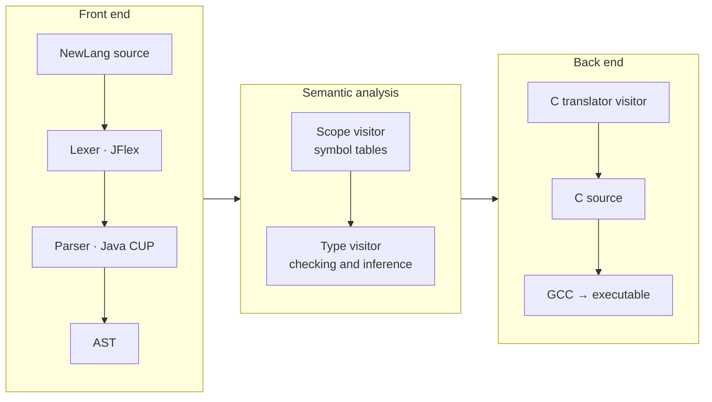

<h1 align="center">NewLang Compiler</h1>

<p align="center">
  <b>A complete compiler from NewLang, a small imperative language, to C, built in Java with JFlex and Java CUP.</b><br>
  Compilers · MSc in Software Engineering and IT Management, University of Salerno · 2023
</p>

<p align="center">
  <a href="#example"><b>🔁 Example</b></a> ·
  <a href="#architecture"><b>🏗️ Architecture</b></a> ·
  <a href="NewLang.pdf"><b>📘 Language specification</b></a> ·
  <a href="#build-and-run"><b>⚙️ Build and run</b></a>
</p>

---

## At a glance

| | |
|---|---|
| **What it does** | Reads a NewLang program, checks it, translates it to C and compiles it with GCC into a native executable |
| **Team** | Vincenzo Esposito and [Davide Prezioso](https://github.com/prezioso3) |
| **My role** | I led the **semantic analysis and code generation**: scoping and symbol tables, type checking and inference, the C translator and the semantic error model. I also wrote the **test suite** |
| **Stack** | Java 17 · JFlex · Java CUP · Maven · GCC |
| **Testing** | 19 test programs: 10 valid and 9 invalid. Every valid program compiles to C and runs; every invalid one is rejected with the expected error |

## Who did what

The project grew over 77 commits between April 2023 and January 2024.

| Area | Vincenzo Esposito | Davide Prezioso |
|---|:---:|:---:|
| Lexer (JFlex) and grammar (CUP) | contributor | **lead** |
| AST nodes and tree builder (`MySyntaxTree`) | shared | shared |
| Scoping and symbol tables (`MyScopeVisitor`, `table/`) | **lead** | contributor |
| Type checking and inference (`MyTypeVisitor`) | **lead** | contributor |
| C code generation (`MyCTranslatorVisitor`) | **lead** | contributor |
| Semantic errors (`exceptions/`) | **lead** | contributor |
| Test programs (valid and invalid) | **lead** | n/a |
| Test script and CI | contributor | **lead** |

## Architecture

Each compilation phase is a separate class, and every phase after parsing is a **Visitor** over the AST. That keeps the phases independent and easy to test.



| Phase | Class | What it does |
|---|---|---|
| Syntax tree | `MySyntaxTree` | Builds the AST and can export it as XML for debugging |
| Scoping | `MyScopeVisitor` | Builds nested symbol tables. Variables and functions can be **used before they are declared**, and an inner scope can shadow an outer one (most-closely-nested rule). Each function, `if`, `else`, `while`, `for` and the program itself opens a scope |
| Typing | `MyTypeVisitor` | Enforces the type system. The only implicit conversion is `integer` → `real`. It **infers** the type of `var x << 10` from the constant and checks calls, returns and `out` parameters |
| Code generation | `MyCTranslatorVisitor` | Emits C:<br>• forward declarations, so functions can be called in any order<br>• `out` parameters as pointers<br>• string helpers (`intToString`, `concat`, …)<br>• a generated `main` that calls the function marked `start:` |

Semantic errors use dedicated exception types:
- `AlreadyDeclaredVariable`
- `MissingItem`
- `MissingReturn`
- `NotFunction`
- `IncompatibleType`
- `IncompatibleParam`
- `IncompatibleNumberParam`
- `IncompatibleReturn`
- `IncompatibleAssignVar`

## Example

This program is in [`examples/`](examples). It is compiled by this compiler, and its output is shown below.

**NewLang source**

```
def fibonacci(integer n): integer {
    integer result;
    result << n;
    if n > 1 then {
        result << fibonacci(n - 1) + fibonacci(n - 2);
    }
    return result;
}

def sequence(integer n | out integer last): void {
    integer i << 1;
    while i < n + 1 loop {
        (fibonacci(i)) -->!;
        i << i + 1;
    }
    last << fibonacci(n);
}

start:
def program(): void {
    integer n, last;
    n <-- "How many terms?";
    sequence(n, last);
    ("Last term:") -->!;
    (last) -->!;
}
```

**Generated C** (excerpt)

```c
void sequence(int, int*);
int fibonacci(int);
void program();

void sequence(int n, int* last) {
    int i = 1;
    while (i < n + 1) {
        printf("%d\n", fibonacci(i));
        i = i + 1;
    }
    *last = fibonacci(n);
}

int fibonacci(int n) {
    int result;
    result = n;
    if (n > 1) {
        result = fibonacci(n - 1) + fibonacci(n - 2);
    }
    return result;
}

void program() {
    int n;
    int last;
    printf("How many terms?\n");
    scanf("%d", &n);
    sequence(n, &last);
    printf("%s\n", "Last term:");
    printf("%d\n", last);
}

int main(int argc, char** argv) {
    program();
    return (EXIT_SUCCESS);
}
```

**Run**

```
$ echo 8 | ./fibonacci
How many terms?
1
1
2
3
5
8
13
21
Last term:
21
```

Notice how the `out` parameter `last` becomes `int*` in C and the call site passes `&last`. The excerpt is re-indented for reading; the full raw output is [`examples/fibonacci.c`](examples/fibonacci.c).

## The language in brief

| Feature | Syntax |
|---|---|
| Types | `integer` · `real` · `string` · `char` · `bool` |
| Declarations | `integer a << 1, b;` · type inference with `var x << 10;` |
| Functions | `def f(integer a, b \| out real r): real { … }` (parameter groups separated by `\|`) |
| Entry point | `start:` before the main function |
| Control flow | `if … then { } else { }` · `while … loop { }` · `for i << 1 to 10 loop { }` |
| Input | `x <-- "prompt";` · `a, b <--;` |
| Output | `(expr, …) -->;` (write) · `(expr, …) -->!;` (write line) |
| Comments | `\|* block \|` · `\|\| line` |

The full specification is in [NewLang.pdf](NewLang.pdf).

## Build and run

Requirements: **Java 17+**, **Maven** and **GCC**.

```bash
mvn compile
mvn exec:java -Dexec.args="examples/fibonacci.txt"
```

The compiler writes the C file to `test_files/c_out/` and the executable to `test_files/exec/`. Maven generates the lexer and parser from [`srcjflexcup/`](srcjflexcup) on every build.

### Test suite

- `test_files/valid*`: 10 programs that must compile, each with its input and expected output.
- `test_files/invalid_*`: 9 programs that must be rejected. They cover a missing function, a missing return, an undeclared variable, a redeclaration, too many parameters, a wrong parameter count, a wrong return type and misuse of an `out` parameter.

## Known limitations

These came up in a review of the project in 2026 and are documented rather than hidden:

- The `>=` comparison is rejected by the type checker; `>`, `<` and `<=` work.
- `var x << 2.2` is inferred as `integer` instead of `real`, so the decimal part is lost.
- `-->` (write without a newline) currently emits a newline, like `-->!`. This is the main reason why some valid tests produce correct values with different line breaks from the expected output.
- The generated C is correct but not pretty-printed.

---

<sub>Vincenzo Esposito · <a href="https://vincenzo-esposit0.github.io/">Website</a> · <a href="https://www.linkedin.com/in/vincenzo-e">LinkedIn</a></sub>
